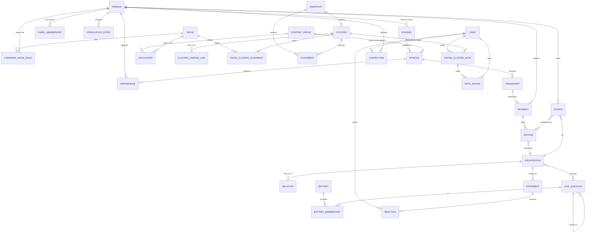

# Dialogos Arena: Data Model v0 and Encounter Discovery Plan

*Draft for review by Benjamin Life (@omniharmonic) · 2026-10-31 · Builds on the Design Memo (2026-10-30), SYNTHESIS §2 / §6 / §7.5–7.7 / §11.1 / §16, B9 §4 (transcript pipeline, as corrected), the Topology Live ontology (`antidebate-live/docs/ONTOLOGY.md`, `packages/ontology`), and SEED-v1 (165 niches, 542 landmarks).*

**How to read this.** Part 1 says *what we store* and *who fills each field*. Part 2 says *how we find the conversations that connect niches* without checking 146,000 pairs. Part 3 lists the decisions only you can make, each with a recommendation. Every cost and volume figure is an **ESTIMATE** unless marked otherwise; prices that were not checked on a vendor page are **UNVERIFIED**.

**Legend used in the tables**

| Mark | Meaning |
|---|---|
| **S** | Filled at seed time (from SEED-v1.json, the verification batches, or manual curation) |
| **P** | Filled by the pipeline (crawl, transcription, extraction, clustering) |
| **H** | Filled by humans in the product (users, landmarks, operators) |
| **D** | Derived / computed from other records (rebuildable) |
| **[OPEN-n]** | A decision not yet made; collected in the table at the end of Part 1 and in Part 3 |

---

## Summary

1. **Two kinds of "group", kept apart.** A **Niche** is a *named, curated hypothesis* (the 165 in the seed). A **Cluster** is what the *data* finds in a given snapshot. Niches seed the crawl and the sampling; clusters carry lineage, membership and note ratification. A crosswalk table records how they line up over time. This keeps "the map we guessed" from being confused with "the map the data drew".
2. **Topology Live's ontology is the content core, unchanged.** Utterance, Span/ADU, Proposition, Stance (with `stated / implied_by_act / inferred`), Relation, Presupposition, the five strata and the `ItemStatus` provenance chain are reused as-is. The Arena adds the *media*, *people*, *time* and *social* layers around it.
3. **Storage:** one Postgres database (with pgvector) plus an append-only event log, a private object store for full transcripts, and a one-way publish into Parachute for the human-readable knowledge layer (niche cards, landmark notes, weekly reports). No graph database is needed at this scale.
4. **Encounter discovery is O(N):** crawl each landmark's own show and their guest appearances elsewhere (about 10–25 API calls per landmark), resolve names to landmarks, and *derive* encounters from the resulting person × episode table. A key shortcut: **any encounter on a landmark-hosted show is found just by listing that show's episodes**, so the expensive name searches are only needed for appearances on third-party shows.
5. **Transcribe selectively:** a coverage set of roughly 300–450 cross-niche episodes chosen so every niche is connected (a value-weighted spanning tree plus redundancy), plus a **fixed hours budget per niche** for solo baseline content. Roughly 5,500–6,500 transcript hours for the full seed, about **$1.5k–5k** in transcription and extraction (ESTIMATE), well under B9's 10,000-hour backfill.
6. **Pilot first** on three niches (AI safety, e/acc, regenerative agriculture) to measure discovery precision and recall, call counts and block rates before the full run.

---

# PART 1: Data model (v0)

## 1.1 Layers at a glance

The Arena wraps Topology Live's layers (MEDIA → DISCOURSE → CONTENT → STANCE → DIALECTIC) with a seed layer underneath and a time-and-social layer on top.

| Layer | Entities | Mostly filled by |
|---|---|---|
| **Seed** (who and what we look at) | Niche, Landmark, Person, PanelMembership, VerificationEvent | S |
| **Media** (where the talk lives) | Channel/Source, Episode (content item), ContentGroup, Transcript, TranscriptSegment (= TL *Utterance*), Appearance | P |
| **Graph** (who met whom) | Encounter, ContentEdge | D, P |
| **Content** (what was said) | Anchor (= TL *Span* + *ADU*), Proposition, Stance, Relation, Presupposition | P (TL pipeline) |
| **Questions** (what is contested now) | LiveQuestion, Battery, BatteryMembership, QuestionLabel, ThreadStateEvent | P, D |
| **People in the product** | User, Statement, Reaction, Placement | H, D |
| **Time** | Snapshot, Cluster, ClusterLineageLink, NicheClusterAlignment | D |
| **Gradient** | CrossClusterNote, NoteRating, NoteScore | H, D |
| **Governance** | Correction/Dispute, EventLog, LlmCall | H, P |

## 1.2 Entity reference

For each entity: purpose, key fields with source (S/P/H/D), relationships. Field names are illustrative; the spec (§16 spec 2, "Arena Ontology v0") will fix them as Zod schemas extending `packages/ontology`.

### Niche (curated, named)

A recognizable worldview scene as named by the seed. **Not** the unit of ratification (that is the data-derived Cluster).

| Field | Src | Notes |
|---|---|---|
| `niche_id`, `name`, `aliases[]`, `description` | S | From SEED-v1. Aliases include outsider labels, kept apart via `alias.kind = self | outsider`. |
| `domain`, `cross_domains[]` | S | d1–d8 seed domains. |
| **Limberg–Barnes columns**: `telos`, `sacred_values[]`, `existential_threats[]`, `combatants[]`, `adjacent_niches[]`, plus empty slots for `master_status`, `campfire`, `chieftains`, `forebears`, `mental_models` | S now; H/D later | The seed fills 5 of the 9 L–B slots. The full 9-slot card is the cluster-card schema (SYNTHESIS §6.4, §13); remaining slots are filled from ratified notes (D2) rather than guessed. `chieftains` = the niche's landmarks (D). |
| `combatant_niche_ids[]`, `adjacent_niche_ids[]` | S→D | Seed stores *names*; resolve to ids once (several seed names refer to merged niches). These are **priors** for niche distance in Part 2. |
| `limberg_barnes_match`, `atlas_match` (+ `atlas_snapshot_date`) | S | 98/165 have an L–B match; 34/165 an Atlas match, against a **partial** Atlas list (39 of 58). Re-match when the full list is in hand. |
| `placement_prior` {`left_right`, `atlas_accelerate_restrain`, `atlas_institutions_exit`, `basis`} | S | Rough QA judgment; used only as a distance prior until content-based placement exists. Never shown as a score. |
| `size_estimate`, `cultural_influence`, `trajectory` | S | Free text with basis. |
| `sub_niches[]` | S | Candidate splits to watch. |
| `version`, `merged_from[]`, `split_into[]`, `valid_from`, `valid_to`, `qa_decision` | S, then H | **Niche lineage over time** (curatorial): a niche is never edited in place; a rename, merge or split creates a new version and links. 33 seed niches already merge two or more raw niches (`merged_from`). |
| `sampling_budget_hours` | S (policy) | Fixed per niche for baseline sampling (Part 2 §2.7). [OPEN-3] |

Relationships: Niche 1—N LandmarkNicheRole; Niche N—N Cluster via **NicheClusterAlignment** (per snapshot).

### Person and Landmark

Every named speaker in our media is a **Person**. A **Landmark** is a Person admitted to the seed panel. Non-landmark persons (third-party hosts, co-guests) are stored minimally so encounters on their shows can be found and so the data can *propose* newcomers. Private individuals (call-in guests, audience members) are **never** stored by name (red line for private individuals; their segments are labeled `speaker: non_public`).

| Field | Src | Notes |
|---|---|---|
| `person_id`, `display_name` | S/P | `landmark_id` from the seed doubles as `person_id` for landmarks. |
| `aliases[]` {text, kind: legal / stage / handle / misspelling / transliteration, source} | S, P | Seed name + Wikidata labels/aliases + platform handles. Drives entity resolution (Part 2 §2.4). |
| `wikidata_qid` | P | Strong disambiguator; also yields channel ids (YouTube channel property) and handles. |
| `ambiguous_name` (bool) + `disambiguators[]` | P/H | E.g., common names; forces review of every match. |
| `is_public_figure` | S/P | Gate for storing a name at all. |
| `voiceprint_ref` | P | Speaker embedding enrolled from solo content; used to confirm appearances and attribute speech. Internal only. |
| **Landmark-only:** | | |
| `roles[]` → **LandmarkNicheRole** {niche_id, role: core / bridger / edge, is_primary, valid_from, valid_to, basis} | S, H | Seed has 542 primary roles plus 58 secondary links (50 with one, 4 with two). Roles are time-bounded so a landmark can drift. |
| `why`, `longform_output`, `active_2025_2026`, `gender` | S | `gender` is kept only for the balance audit (R48), never displayed per person. [OPEN-10] |
| `flag_for_benjamin`, `exclusion_status` | S/H | 12 landmarks carry a flag in SEED-v1. |
| **PanelMembership** {season, status: core_panel / newcomer / retired / excluded, admitted_at, admitted_by, reason} | S, H | The guard against sampling drift (memo §9). Newcomers are visibly marked in every view and are excluded from "movement" statistics for their first season. [OPEN-2] |
| `claim_status`: unclaimed / claimed / opted_in (OAuth channel connection) | H | Unlocks the ToS-compliant caption route (B9) and the dispute portal. |
| `dispute_status`: none / open / annotated / resolved | D | Rolled up from Correction records. |
| **VerificationEvent** {at, status: verified-active / stale / pending / excluded, evidence_url, evidence_date, platform_corrections, by} | S, P | Verification *history*, not a single flag. Seeded from `verify/batch-*.json` (168 verified-active, 179 pending, 2 stale, 1 excluded so far). Re-run each season. |

### Channel / Source

A place content is published: a YouTube channel, a podcast feed, a Substack, a Bluesky account, a website.

| Field | Src | Notes |
|---|---|---|
| `channel_id`, `platform` (youtube / podcast_rss / substack / bluesky / x / website) | S→P | The seed holds mostly **names, not ids**: only 95 of 150 YouTube entries are URLs. Resolving to stable ids is Phase 0 of the run plan. |
| `external_ids` {yt_channel_id, uploads_playlist_id, podcastindex_feed_id, itunes_collection_id, rss_url, podcast_guid} | P | |
| `owner_person_id` (nullable) | S/P | Null for third-party shows. |
| `hosts[]` (person ids) | P | |
| `show_format_prior` (interview / solo / panel / news / clips) | P | Helps the episode-format classifier. |
| `default_transcript_route` | P | yt_caption / publisher_transcript / stt / opt_in. |
| `rights_notes`, `takedown_contact` | P/H | |
| Crawl state: `last_crawled_at`, `etag`, `episode_count`, `block_rate_7d` | P | Switch to RSS/STT or opt-in when YouTube blocking rises (R49). |

### Episode (content item) and ContentGroup

One published item: a video, a podcast episode, an essay. The same conversation often exists as a YouTube video *and* an RSS episode *and* clips; a **ContentGroup** ties them so encounters and propositions are not double-counted.

| Field | Src | Notes |
|---|---|---|
| `episode_id`, `channel_id`, `platform`, `url`, `external_id` (video id / RSS guid) | P | |
| `content_group_id` | P | Dedup by title similarity + date ± 3 days + duration ± 5%. |
| `title`, `description`, `published_at`, `duration_s`, `language` | P | |
| `format`: interview / debate / panel / solo / roundtable / clip / compilation / essay | P | Clips and compilations never count as encounters. |
| `discovered_via[]` {method, query, api, at} | P | Provenance of discovery. |
| `participants` | D | Via Appearance. |
| **Transcript availability** `transcript_status`: unknown / yt_caption_available / publisher_transcript / none / queued / fetched / failed | P | |
| `transcript_provenance` | P | Points to the chosen Transcript version. |
| **Rights status** `rights_status`: public_unlicensed / publisher_published_transcript / opted_in / licensed / takedown_requested / removed | P/H | Governs what may be shown. |
| `selected_for[]`: coverage / baseline / event_map / none, with `selection_run_id` | D | Why we transcribed it. |
| `quality` {longform_ok, guest_share, audio_ok, caption_kind} | P/D | Inputs to the coverage score. |

### Transcript and TranscriptSegment

| Entity | Field | Src | Notes |
|---|---|---|---|
| **Transcript** (versioned) | `route`: yt_caption_auto / yt_caption_creator / publisher / stt_vendor / stt_selfhosted / opt_in_oauth | P | Several versions per episode allowed (e.g., captions first, STT later for an event map). |
| | `vendor`, `model`, `fetched_at`, `has_diarization`, `has_word_timestamps`, `quality` (est. WER, caption kind) | P | |
| | `storage_ref` (private object store), `retention_until` | P | Full text internal only (SYNTHESIS §11.1). |
| | `rights_basis` | P | Mirrors episode rights. |
| **TranscriptSegment** = Topology Live **Utterance** | `segment_id`, `transcript_id`, `seq`, `start_ms`, `end_ms`, `text`, `words[]` | P | Same shape as TL `Utterance`; `words[]` kept in the object store, not Postgres. |
| | `diar_label`, `person_id` (nullable; `non_public` allowed), `attribution` {confidence, signals: metadata / voiceprint / caption cue, confirmedBy: auto / operator} | P/H | TL's `AttributionSignals` reused. B9: speaker misattribution is the highest-harm failure, so publication needs `confidence ≥` a threshold. [OPEN-6] |

### Appearance (person × episode × role)

| Field | Src | Notes |
|---|---|---|
| `person_id`, `episode_id` (or `content_group_id`), `role`: host / co_host / guest / panelist / moderator / debater / clip_subject | P | |
| `evidence`: title / description / show_notes / podcast:person tag / guest list API / diarization | P | |
| `mention_type`: present / discussed_only / clip_only | P | Descriptions often *mention* people who are not on the show. Only `present` creates encounters. |
| `resolution_confidence` (0–1), `resolution_method` | P | Part 2 §2.4. |
| `speaking_share` | P (post-transcript) | From diarization; confirms presence. |
| `status`: candidate / accepted / rejected / verified_by_audio | P/H | |

### Encounter (derived edge between niches)

An episode where participants from **different niches** were present together. Computed, never hand-entered.

| Field | Src | Notes |
|---|---|---|
| `encounter_id`, `content_group_id` | D | |
| `person_a`, `person_b`, `niche_a`, `niche_b` (canonical order) | D | One row per cross-niche pair in the episode; a 4-person panel can create several. Niche = the person's primary niche at episode date (secondary niches as weight 0.5, [OPEN-4]). |
| `type`: host_guest / co_guest / debate / panel | D | |
| `niche_distance_prior` | D | Part 2 §2.6. |
| `quality_score` | D | Part 2 §2.6. |
| `sign`: unknown / integrative / sparring / mixed | P (S4, later) | From classified stances after extraction (SYNTHESIS §6.1 S4). |
| `selected_for_coverage`, `selection_run_id` | D | |
| `confidence` | D | min of the two appearance confidences. |

**ContentEdge** (secondary, after extraction): `from_person`, `to_person`, `type`: quotes / names_to_rebut / names_to_endorse, `anchor_id`, `stance_sign`. This is D14's "who quotes whom, who argues with whom by name", and does not require co-presence.

### Anchor (quote anchor) = Topology Live Span + ADU

The exact words behind a stance. Society Library-style: one proposition, many anchors.

| Field | Src | Notes |
|---|---|---|
| `anchor_id`, `segment_id`, `char_start`, `char_end`, `quote_full` (internal) | P | TL `Span`. The deterministic validator checks the quote string-matches the segment; **no match, no proposition**. |
| `quote_public` (≤ about one sentence) | P | The only text shown publicly. |
| `speech_act` (TL's 13 acts) | P | `attribute`, `steelman_report` and `nonliteral` never commit the speaker (TL §8.5). |
| `speaker_person_id`, `speaker_conf` | P | |
| `t_start_ms`, `t_end_ms`, `deep_link` (url with `?t=`) | P | The "source clip". |
| `published_at` (of episode) | D | Gives each stance its time. |

### Proposition (shared, speaker-independent)

TL `Proposition` unchanged, plus time and bank fields.

| Field | Src | Notes |
|---|---|---|
| `id`, `canonical`, `type` (10 TL types), `stratum` (praxis / empirical / axiology / epistemology / ontology), `scope`, `conditions`, `quantities`, `forecast`, `aboutConcepts`, `status` (`ItemStatus`) | P | TL as-is. Layer tags from Jev map onto `stratum` (real → ontology; how we know → epistemology; what matters → axiology; empirically true → empirical; what to do → praxis). |
| `validity_tag`: truth / rightness / sincerity | P | Orthogonal tag (SYNTHESIS §5.1). |
| `first_seen_at`, `first_seen_anchor_id`, `first_seen_person_id` | D | "First seen" means first in *our corpus*, so it depends on backfill depth; show it as "earliest found". |
| `embedding` (pgvector) | P | For identity resolution and clustering. |
| `merged_into` (nullable), `bank_version` | P/H | Identity resolution never deletes; merges are reversible events. |

### Stance

TL `Stance` with the participant key generalized to a person and media time replaced by real time.

| Field | Src | Notes |
|---|---|---|
| `person_id`, `proposition_id`, `anchor_ids[]` | P | |
| `attitude` (accepts / rejects / suspends / accepts_conditionally / accepts_for_argument), `strength` (tentative … certain), `credence` (only if stated) | P | TL enums. |
| `source`: **stated / implied_by_act / inferred** | P | Exactly TL's `StanceSource`; matches the request's stated/implied/inferred. Only `stated` or better counts toward scores (SYNTHESIS §5.3). |
| `as_of` (episode date), `episode_id` | D | Stances are readings at a moment (memo §9). |
| `status` (`ItemStatus`) | P/H | Landmark disputes move it to `participant_contested`. |

Relation, Presupposition, Concept/Sense/Drift, Crux and HigherGround are reused from TL without change, scoped to an episode (event map) or to the bank.

### LiveQuestion (live thread), Battery, labels

Named `LiveQuestion` to avoid clashing with TL's in-dialogue `Question` ledger (who asked whom, answered or evaded).

| Entity | Field | Src | Notes |
|---|---|---|---|
| **LiveQuestion** | `id`, `text` (neutral, signable by both sides), `parent_id`, `base_question_id`, `origin_cluster_id`, `origin_niche_id` | P/H | B9's EGP-style genealogy. |
| | `first_seen` {anchor_id, person_id, at} | D | |
| | `chosen_axes[]` (2–3, per question), `axes_fit_snapshot_id` | D | D7. |
| | `lifecycle_state`: emerging / spreading / forking / crossing / quiet / absorbed | D | |
| | `adopted_by_clusters[]` | D | Basis for lineage credit. |
| **ThreadStateEvent** | `question_id`, `from`, `to`, `at`, `snapshot_id`, `evidence` | D | Life-cycle history. |
| **Battery** | `id`, `week`, `model`, `prompt_version`, `sample_spec` (niche-balanced) | P | Weekly proposal run. |
| **BatteryMembership** | `battery_id`, `question_id`, `rank`, `status`: proposed / included / retired | P/H | |
| **QuestionLabel** | `item` (anchor or segment), `question_id`, `probs`, `stratum_tag`, `labeler` (Jev / fallback), `labeler_version` | P | The daily cheap tagging. |
| *answers link* | Relation `answers` between Proposition and LiveQuestion | P | Reuses TL's relation type. |

### Statement, Reaction, User, Placement

| Entity | Field | Src | Notes |
|---|---|---|---|
| **Statement** | `id`, `proposition_id`, `display_text`, `primary_anchor_id` (source clip), `selection_reason`: cluster_splitter / live_thread / surprising_unifier, `reveal_person_id`, `active_from/to` | D/H | A proposition chosen to be reacted to. |
| **Reaction** | `user_id`, `statement_id`, `vote`: agree / disagree / pass, `guess_person_id` (optional), `created_at`, `consent_version` | H | Private by default. Latest vote wins for placement; history kept in the event log. |
| **User** | `id`, `identity_tier`, `personhood_method`, `consents[]`, `age_gate_passed` | H | |
| **Placement** | `subject` (landmark or user), `snapshot_id`, `coords[]`, `cluster_id`, `uncertainty`, `basis`: content / reactions | D | Landmarks from extracted stances; users from reactions; same space. |

### Snapshot, Cluster and lineage

| Entity | Field | Src | Notes |
|---|---|---|---|
| **Snapshot** | `id`, `horizon`: daily / weekly / monthly, `as_of`, `data_window`, `panel_season`, `bank_version`, `model_versions`, `params`, `code_ref` | D | Immutable once written. Daily snapshots hold only pulse metrics; weekly re-cluster; monthly re-fit axes. |
| **Cluster** | `id`, `snapshot_id`, `label` (provisional, D; ratified later via notes), `n_landmarks`, `n_users`, `centroid` | D | |
| **ClusterLineageLink** | `from_cluster` (t), `to_cluster` (t+1), `type`: continues / splits / merges / born / fades, `overlap` (e.g., Jaccard on landmark members), `confidence` | D | Births, splits, merges, fadings (D19). Computed on **core-panel landmarks only** first, so newcomers cannot fake movement. |
| **NicheClusterAlignment** | `niche_id`, `cluster_id`, `snapshot_id`, `share_of_niche_landmarks`, `share_of_cluster` | D | Shows where a curated niche is one cluster, spread across several, or merged with another: the "data reveals missed clusters" check. |

### Cross-cluster note and ratings

| Entity | Field | Src | Notes |
|---|---|---|---|
| **CrossClusterNote** | `id`, `author_user_id`, `author_cluster_id` + `author_snapshot_id` (at writing), `target_cluster_id`, `text`, `cited_anchor_ids[]`, `agent_drafted`, `parent_note_id` (after a split) | H | Describe, never judge. |
| | `status`: not_yet_ratified / ratified_by_B / B_split / anchor_disputed | D | Society Library-style labels. |
| **NoteRating** | `note_id`, `rater_user_id`, `rater_cluster_id`, `channel`: **fidelity** / **portability**, `value`, `sealed_until` | H | Fidelity raters are randomly sampled from reaction-placed members of B; agents never rate. |
| **NoteScore** | `note_id`, `snapshot_id`, `fidelity`, `portability_intercept` (matrix factorization), `split_detected`, `subcluster_ids[]` | D | Feeds the R matrix (the gradient). |

### Correction / dispute

One table for every kind of "that's wrong".

| Field | Src | Notes |
|---|---|---|
| `id`, `raised_by` (user / landmark / operator / rights holder), `kind`: thats_not_me / placement_dispute / landmark_annotation / anchor_misattribution / proposition_unfaithful / niche_label_dispute / takedown | H | |
| `target_type`, `target_id` (polymorphic) | H | |
| `text`, `state`: open / triaged / accepted / rejected / annotated, `resolution`, `resolved_by`, `resolved_at` | H | Landmark annotations can stay visible beside a placement even if not "accepted". |
| `label_example_id` | D | Every accepted correction becomes a labeled example (D16). |

### Event log and call log

- **EventLog** (append-only, as in Topology Live): `event_id`, `type`, `actor` (pipeline pass + version, user, operator), `entity_refs`, `payload`, `at`. Every create/merge/status change on the entities above is an event; tables are projections that can be rebuilt. This is what makes the four-dimensional map and audit trails cheap.
- **LlmCall**: reuse TL's `llm_calls` table (pass, prompt version, model, tokens, cost).

## 1.3 Entity–relationship diagram

*(Placement's subject is a Person or a User; Correction targets any entity. Polymorphic links are omitted from the diagram for legibility.)*

## 1.4 Seed time vs pipeline: what exists on day one

| At seed load (from SEED-v1 + verify batches) | Filled by the discovery crawl (Part 2) | Filled by transcription + extraction | Filled by people |
|---|---|---|---|
| 165 Niches with 5 L–B columns, priors, Atlas/L–B matches | Channel ids, Episodes, ContentGroups, Appearances, Encounters, Wikidata QIDs, aliases | Transcripts, Segments, Anchors, Propositions, Stances, Relations, LiveQuestions, labels | Reactions, Notes, Ratings, Corrections, landmark annotations, panel decisions |
| 542 Landmarks, primary/secondary roles, platforms (as text), flags | Verification refresh (activity dates) | Speaking share, voiceprints, ContentEdges, encounter sign | Placements of users (D from reactions) |
| VerificationEvents (347 entries checked or queued) | | Snapshots, Clusters, lineage (D) | |
| PanelMembership season 0 (all core_panel) [OPEN-2] | | | |

## 1.5 Storage recommendation

| Store | Holds | Why |
|---|---|---|
| **Postgres** (Neon, as Topology Live already uses, with Drizzle) | All entities above except bulk text | Relational integrity; the scale is modest (≈ 75k episode records, ≈ 3–4M segments at full seed, ≈ 100k–300k propositions: ESTIMATES). |
| **pgvector** (same database) | Proposition embeddings; episode title/description embeddings | Identity resolution, dedup, topic stratification; avoids a second system. |
| **EventLog table** (append-only) | Every state change | Rebuildable projections, time travel, audit; same pattern as TL's `events` + `snapshots`. |
| **Private object store** (S3 / R2) | Full transcripts, word timings, caption files, voiceprints | Kept out of the public data path; retention policy per SYNTHESIS §11.1; easy to purge on takedown. |
| **Analysis workers** (Python: igraph / networkx, scikit-learn) | Graph projection, coverage selection, clustering | Read from Postgres, write results back as derived tables. **No graph database needed** at ~600 persons and ~75k episodes. |
| **Git** | SEED-v1.json, niche/landmark curation, selection-run configs | Seed-time fields stay reviewable as diffs; a loader script upserts them. |
| **Parachute vault** (knowledge layer) | Human-readable notes: one note per niche (card), per landmark (profile + dispute log summary), weekly weather and monthly reports, event-map write-ups, design decisions | Parachute is where *you* read, link and think; Postgres is where the *machine* works. **One-way publish** (Postgres → Parachute) on each weekly snapshot, using a distinct tag (e.g., `#arena/landmark`, `#arena/niche`) so landmarks never mix with your personal `#person` contacts. Edits you make in Parachute come back only as Correction or curation events, never by silent sync. [OPEN-9] |

## 1.6 Open decisions in the data model

| # | Decision | Recommendation |
|---|---|---|
| OPEN-1 | Show niche names or data cluster names on the public map? | Show **cluster** hulls, labeled with the best-aligned niche name until a ratified label exists; mark "provisional". |
| OPEN-2 | Is all of SEED-v1 the season-0 core panel, or only verified-active landmarks? | Core panel = verified-active, non-flagged landmarks after the verification queue closes; the rest enter as season-0 newcomers. |
| OPEN-3 | Baseline hours per niche | 30 h per niche (≈ 5,000 h total); 15 h for the pilot. |
| OPEN-4 | How secondary niches count in encounters | Weight 0.5; never used to *close* a coverage gap alone. |
| OPEN-5 | Episode identity across platforms | ContentGroup as the unit for encounters and propositions; episodes as the unit for links. |
| OPEN-6 | Speaker-confidence threshold for public quotes | 0.9 for publication; 0.7–0.9 internal only; below 0.7 discarded. Calibrate in the pilot. |
| OPEN-7 | Store non-landmark public hosts as Persons? | Yes, minimally (name, QID, channel); they are newcomer candidates and venue nodes. Never store private individuals. |
| OPEN-8 | "First seen" depth | Backfill window from 2024-01-01; label as "earliest found in corpus". |
| OPEN-9 | Parachute sync direction and tags | One-way publish weekly; dedicated `#arena/*` tags. |
| OPEN-10 | Keep `gender` in the seed? | Keep for aggregate balance audits only; never per-person display. |

---

# PART 2: Encounter discovery without combinatorial explosion

## 2.1 The problem in numbers

| Quantity | Value |
|---|---|
| Landmarks | 542 |
| Possible landmark pairs | 542 × 541 / 2 = **146,611** |
| Niches | 165 |
| Possible niche pairs | 165 × 164 / 2 = **13,530** |
| Minimum encounters to connect all niches | 164 (a spanning tree) |

Searching "did A ever meet B?" for every pair would mean ~146k searches and still miss most results. Instead we **crawl each landmark once** (cost grows with the number of landmarks, not pairs), build a table of *who appeared in which episode*, and let the pairs fall out of that table.

## 2.2 Why O(N) works: the bipartite graph

1. Crawl produces **appearances**: person × episode, with a role.
2. That is a **bipartite graph** (people on one side, episodes on the other).
3. **Projection:** two people are linked if they share an episode; edge weight = number of shared episodes (and their quality). Then collapse people into their niches to get the **niche–niche encounter graph**.
4. Only episodes with two or more landmarks from different niches create encounters. Most episodes have one or two named people, so the projection is cheap (linear in appearances).

**Shortcut that saves most of the cost:** if landmark B is a guest on landmark A's show, A's own episode list already reveals it. Listing all ~330 landmark shows (cheap list calls) finds **every host–guest encounter between landmarks**. The expensive name searches in step (b) are only needed to find (i) landmarks meeting on **third-party** shows (panels, debates, neutral hosts such as interviewers who are not on the list) and (ii) appearances of the **~208 landmarks (38%) with no YouTube or podcast listed in the seed** (often politicians, authors and executives who mostly appear as guests).

## 2.3 The crawl, per landmark

| Step | What | Sources (key needed?) | Calls per landmark (ESTIMATE) |
|---|---|---|---|
| **0. Registry** | Resolve stable ids: YouTube channel id and uploads playlist; Podcast Index feed id; Apple collection id; RSS URL; Substack feed; Wikidata QID, aliases and handles | YouTube Data API `channels.list` by handle (key), `search.list` only if no handle; Podcast Index search (key); iTunes Search (no key); Wikidata (no key) | 3–6 |
| **(a) Own show** | List episodes in the backfill window (from 2024-01-01 [OPEN-8]); title, description, date, duration; guests | YouTube `playlistItems.list` (50 items per call) + `videos.list` for durations (50 ids per call); RSS fetch (no key); Podcast Index `episodes/byfeedid`; Podcasting 2.0 `<podcast:person>` tags where present | 4–15 (pages) |
| **(b) Appearances elsewhere** | Episodes on other shows featuring the landmark | Podcast Index `search/byperson` (uses person tags and text) (key); Listen Notes episode search by name (key, paid tier likely); Apple iTunes Search `entity=podcastEpisode` (no key, rate-limited); YouTube `search.list` with the name + "interview" / "podcast" / "debate", windowed by date (key, expensive in quota); show-notes pages fetched only for candidate hits (robots.txt respected) | 6–12 |
| **(c) Text output** | Substack / blog RSS for essays (baseline for low-longform landmarks) | RSS (no key) | 1–2 |
| **Guest extraction** | Pull named people out of titles, descriptions and show notes; classify each mention as present / discussed / clip | Small LLM pass + rules ("with", "ft.", "guest:", "vs") | Batch, not per call |

**Total: about 15–35 calls per landmark, ≈ 8k–19k calls for the full seed (ESTIMATE),** dominated by free or cheap metadata endpoints. YouTube search is the only expensive step (see §2.8).

**Expected output (ESTIMATES, to be measured in the pilot):**

| Item | Estimate | Basis |
|---|---|---|
| Landmark-owned shows | ~330 | 334 landmarks list a YouTube or podcast presence; some share shows |
| Episodes in window from own shows | ~45k–70k | ~330 shows × 140–210 episodes over ~34 months (weekly to several per week) |
| Guest appearances found elsewhere | ~5k–12k | ~10–20 per landmark, highly skewed (some have hundreds) |
| ContentGroups after cross-platform dedup | ~40k–65k | |
| Candidate cross-niche encounter episodes | ~1.5k–5k | Hypothesis; the pilot measures it |
| LLM guest-extraction cost | ~$10–100 | ~60k–80k descriptions × ~400 tokens ≈ 24–32M input tokens at cheap-to-mid tier prices (illustrative, as in B9) |

## 2.4 Entity resolution: names → landmark ids

Descriptions say "Bobby Kennedy", "RFK", "@handle", or misspell names; two different people share names. Each candidate mention goes through:

| Stage | Method | Output |
|---|---|---|
| 1. Normalize | Lowercase, strip honorifics and punctuation, transliterate | Clean string |
| 2. Candidate match | Exact alias match → token-sort fuzzy match → handle match → nickname list | Candidate landmark ids |
| 3. Context features | Show's niche vs landmark's niche; landmark's `why` keywords in description; episode date inside the landmark's active window; co-mentioned people; channel owner; Wikidata occupation | Feature vector |
| 4. Score | Simple calibrated model (logistic regression) trained on the pilot's hand-labeled mentions; `ambiguous_name` landmarks always routed to review | `resolution_confidence` 0–1 |
| 5. Decide | **≥ 0.90** accept · **0.60–0.90** review queue (stronger model with a web check, or a person) · **< 0.60** drop | Appearance status |
| 6. Confirm after transcription | Voiceprint match against the landmark's solo content + diarized speaking share > ~10% | `verified_by_audio`; false "appearances" (mentioned, not present) rejected |

Mentions that do not match any landmark but are clearly public figures appearing repeatedly with landmarks are stored as **non-landmark Persons** (OPEN-7) and reported as **newcomer candidates** each season.

## 2.5 From appearances to graphs

| Graph | Nodes | Edge rule | Use |
|---|---|---|---|
| Bipartite B | Persons, ContentGroups | Accepted appearance with `mention_type = present` | Source of truth |
| Person–person P | Persons | Shared ContentGroup; weight = Σ quality | Threshold-person detection (bridgers), hub detection |
| Niche–niche G | Niches | Any cross-niche encounter; weight = best and total quality | Coverage, gap list |

**Hub caution.** A few mega-hosts (e.g., the Rogan-verse longform shows) will connect dozens of niches through one chair. That is real, but if the map's connectivity rests on one host it shows *that host's* framing of each scene. The coverage step therefore caps how many selected episodes may share a host (§2.6), and every encounter keeps the D21 caveat: **bridgers are not cores**, so encounter content never replaces each niche's own baseline.

## 2.6 Coverage optimization: choose few episodes, connect everything

**Goal.** Choose the smallest set of encounter episodes to transcribe such that every niche is linked to the giant component through cross-niche encounters, favouring encounters between **distant** niches and **good longform** conversations, with some redundancy.

**Episode value** (per candidate encounter episode e joining niches i and j):

`value(e) = distance(i, j) × quality(e) / hours(e)`

| Ingredient | How it is computed (v0, before any content exists) | Later (after extraction) |
|---|---|---|
| `distance(i, j)` (0–1) | Blend of seed priors: different `placement_prior` (left/right, Atlas axes), different domain, listed as **combatants** (high), listed as **adjacent** (low) | Proposition-based distance between niche stance profiles |
| `quality(e)` (0–1) | Duration ≥ 45 min; format = interview / debate / panel (not clip or compilation); both landmarks present (not "discussed"); captions or publisher transcript available; recency; guest speaking share once known | + diarization quality, encounter sign (integrative vs sparring) |
| `hours(e)` | Duration | |

**Selection algorithm (simple and explainable):**

| Step | Method | Result |
|---|---|---|
| 1. Backbone | **Maximum-value spanning forest** over G (Kruskal with union-find): for each niche pair keep its best episode, then add pairs in order of value, skipping pairs already connected. Panels with 3+ niches count as one choice that merges several components (greedy "most components merged per hour" for those). | ≤ 164 episodes if G is connected; a forest plus a list of **isolated niches** if not |
| 2. Redundancy | Ensure each niche has encounters with **≥ 2 different partner niches** where they exist (so no niche hangs on one episode), cheapest valuable additions first | +80–150 episodes |
| 3. Long-range chords | Add high-distance encounters that most reduce the average hop distance between niches, until the budget is used | +50–150 episodes |
| 4. Constraints throughout | Max ~5 selected episodes per host; max ~3 per landmark; prefer core-panel landmarks; at least one encounter per niche must involve a *core* (not only bridgers) where one exists | Diversity, less hub bias |

This is a greedy, Steiner-tree-flavoured set-cover heuristic: not guaranteed optimal, but transparent, fast, and good enough at this size. **Expected size: ~300–450 episodes ≈ 450–700 transcript hours (ESTIMATE).**

**Output 1: Coverage report.** Components, isolated niches, per-niche degree, hop-distance matrix, which hosts carry the most connectivity.

**Output 2: Gap list (invitations for Arena-hosted anti-debates).** Niche pairs that have never met (or met only through sparring once signs are known), ranked by **hole size**:

`hole(i, j) = distance(i, j) × (hops_in_G(i, j) − 1)` (infinite hops for disconnected components, capped)

…boosted when the pair are listed **combatants** (a known fault line with no conversation) and when both niches have a landmark marked as a bridger (more likely to accept). The top 20–30 become invitation candidates under the right-to-enclave rule (invitations, never forced exposure; SYNTHESIS §7.7). Isolated niches go to the top regardless.

## 2.7 Solo baseline sampling: by niche, not volume

Encounter content shows people at their most open; each niche's everyday output is the baseline (memo §11.3). Sampling rule:

| Rule | Detail |
|---|---|
| Fixed budget per niche | e.g., **30 h per niche** (OPEN-3), regardless of how loud the niche is |
| Split inside a niche | By role, then even across landmarks: e.g., core 50%, bridger 30%, edge 20%; a landmark's unused share flows to others in the same niche |
| Eligible items | Solo monologues, own-show episodes with same-niche guests, essays (text-only landmarks); **exclude** the cross-niche encounters already selected |
| Stratify by time | Even spread across quarters of the backfill window (needed for lineage and "first seen") |
| Stratify by topic | Cluster each landmark's titles/descriptions by embedding; draw across clusters so one hot topic does not dominate |
| Prefer cheap routes | Publisher transcripts and captions first; STT only where needed |
| Low-longform landmarks | 32 landmarks are marked low longform; use essays/posts as their baseline and flag lower confidence |

**Expected size:** 165 niches × 30 h ≈ **5,000 h** (vs B9's 500 × 20 h = 10,000 h; ESTIMATE).

## 2.8 Rate limits, terms of service and keys

| Source | Key needed? | Limits (as known; verify) | ToS notes |
|---|---|---|---|
| **YouTube Data API v3** | Yes (Google Cloud API key) | Default quota 10,000 units/day; `search.list` = 100 units; `channels.list`, `playlistItems.list`, `videos.list` = 1 unit each | Metadata via the official API is compliant. Developer Policies limit how long API data may be stored without refresh (check current wording; reportedly ~30 days for some data). Quota increases need an application/audit. |
| **YouTube captions** (transcript service or `youtube-transcript-api`) | Service: yes (paid); library: no | Rate limits and cloud-IP blocks at scale | **ToS gray area, registered risk R49, not a blocker** (B9 correction). Pace requests; fall back per channel to RSS/STT or landmark opt-in; never evade blocks ourselves. Service pricing **UNVERIFIED**. |
| **Podcast Index** | Yes (free key + secret, signed header) | Generous (UNVERIFIED) | Open index; supports `<podcast:person>` and transcript tags. |
| **Listen Notes** | Yes | Free tier small; paid tiers per month (numbers UNVERIFIED) | Check terms on storing results and attribution ("Powered by" requirement likely). Use for discovery, keep only ids and minimal metadata. |
| **Apple iTunes Search API** | No | About 20 calls/minute (Apple's guidance; verify) | Metadata only; pace at ≤ 15/min. |
| **Spotify Web API** | Yes (client credentials) | Rate-limited per app | Developer terms restrict using Spotify content for training ML models (verify current wording). **Lowest priority**; use only to confirm an episode exists, not as a content source. |
| **Wikidata** | No | Polite use; SPARQL timeouts | CC0 data; ideal for aliases and ids. |
| **RSS feeds, show-notes pages, Substack** | No | Be polite (≤ 1 request/s per host) | Respect robots.txt; RSS enclosures are published for download. |
| **STT vendors** (AssemblyAI, Deepgram, OpenAI, self-hosted WhisperX) | Yes (except self-hosted) | Vendor quotas | Prices from B9 (vendor-adjacent source; verify): AssemblyAI U-2 ≈ $0.15/h + $0.02/h diarization. |
| **Taddy, Podscan** (optional) | Yes | UNVERIFIED | Only if their terms allow analysis use. |

**YouTube quota arithmetic (ESTIMATE).** Per landmark: registry ~1–100 units (100 only when a search is needed to find the channel) + own-show listing ~10–20 units + 2–4 name searches × 100 = **~250–550 units**. For 542 landmarks: **~135k–300k units ≈ 14–30 days** at the default 10,000/day. Ways to cut it:

1. Run podcast-index sources first; spend YouTube searches only on landmarks whose podcast results are thin (likely halves the searches).
2. Use `channels.list` by handle (1 unit) wherever the seed has a handle, instead of search.
3. Apply for a quota increase before the full run.
4. Pace the crawl over three to four weeks anyway, which also suits the captions backfill.

**Keys to obtain before the pilot:** Google Cloud project + YouTube Data API key; Podcast Index key/secret; Listen Notes key (decide tier after the pilot); an STT vendor key (AssemblyAI recommended for price and diarization); a transcript-service key once chosen (Q34); optionally Spotify client credentials.

## 2.9 Volumes and costs (all ESTIMATES)

| Item | Hours / volume | Unit cost (source) | Cost |
|---|---|---|---|
| Discovery API calls | ~8k–19k calls | Mostly free tiers; Listen Notes paid month UNVERIFIED | ~$0–200 |
| Guest extraction (LLM) | ~25–30M tokens | Illustrative B9 prices | ~$10–100 |
| Coverage set transcription | ~450–700 h | **STT with diarization** (needed for speaker attribution): $0.17/h AssemblyAI (B9) | ~$80–120 |
| Baseline transcription | ~5,000 h | Captions/publisher first (service price UNVERIFIED); if all STT: $0.17/h (AssemblyAI) to $0.46/h (Deepgram) | **≤ $850–2,300** upper bound |
| Proposition extraction | ~5,500–5,700 h | B9: ≈ $1,080 per 10,000 h at mid tier; ≈ $80–160 at cheap tier | ~$50–620 |
| Storage | ~2–3 GB text | negligible | ~$0 |
| **Full seed total** | **~5,500–6,500 transcript hours** | | **≈ $1.5k–5k** plus transcript-service fees (UNVERIFIED) and engineering time |
| Ongoing (weekly) | New episodes only: RSS/playlist polling (~1–3 calls per show per week); transcribe only sampled items | B9's 3 h/week/landmark is unverified; niche budgets cap it | Far below B9's $13k–36k/year full-STT figure if niche budgets hold |

## 2.10 Phased run plan

| Phase | Scope | Work | Exit criteria |
|---|---|---|---|
| **0. Registry** (≈ 1 week) | All 542 | Close the verification queue (179 pending); resolve channel ids, feed ids, QIDs, aliases; mark `ambiguous_name`; obtain keys | ≥ 95% of landmarks with at least one resolved source or marked "guest-only" |
| **1. Pilot** (≈ 2 weeks) | 3 niches, ~13 landmarks: **ai-safety-xrisk** (5) and **effective-accelerationism** (3), listed combatants with plenty of longform and known cross-talk; **regen-ag-food-freedom** (5), a distant niche whose two core voices have no YouTube or podcast in the seed, testing the guest-only path | Full crawl (a)+(b); hand-label a gold set: every 2025 appearance of 8–10 landmarks, found manually; run resolution; build graphs; run coverage selection on the pilot; transcribe ~50–100 h; extract | Discovery recall ≥ 0.8 and precision ≥ 0.9 against the gold set; measured calls/landmark, episodes/landmark, block rate, $/h; resolution thresholds calibrated |
| **2. One domain** (≈ 2 weeks) | d3 tech-futures (23 niches) or the domain with the most bridgers | Same pipeline, YouTube searches limited to thin-result landmarks | Coverage report for the domain; cost model updated |
| **3. Full crawl** (≈ 3–4 weeks, paced) | All 165 niches | Crawl, resolve, review queue, graph projection | Global coverage report, isolated-niche list, gap list v1 |
| **4. Selection and transcription** (≈ 3–6 weeks, paced) | Coverage set + niche baselines | Captions backfill (paced), STT for encounters and gaps, extraction into the proposition bank | Bank v1; first snapshot; first event-map candidates (Q31) |
| **5. Steady state** | Weekly | Incremental crawl of new episodes; daily pulse tagging; weekly re-selection; seasonal panel review | Daily/weekly/monthly products running |

**Hypotheses the pilot should test, not assume:** that most niches join one giant component through landmark shows alone; that the remaining isolates cluster in religion and lifestyle domains where cross-talk is rarer; that YouTube search adds little beyond podcast indexes for well-known guests.

---

# PART 3: Open questions for Benjamin

| # | Question | Recommendation |
|---|---|---|
| 1 | **Niche vs cluster on the public map** (OPEN-1). Show your curated niche names, or only data-derived clusters? | Data clusters as the shapes; niche names as provisional labels until notes ratify one. Keeps "what we guessed" honest. |
| 2 | **Season-0 core panel** (OPEN-2). Everyone in SEED-v1, or only verified-active landmarks? | Verified-active and unflagged only; others enter as marked newcomers. Decide the 12 flagged landmarks individually first. |
| 3 | **Baseline budget per niche** (OPEN-3). | 30 h per niche for the full seed (≈ 5,000 h), 15 h in the pilot; revisit once extraction yield per hour is measured. |
| 4 | **Pilot niches.** AI safety + e/acc + regenerative agriculture? | Yes. Two combatant niches with heavy longform and one distant, guest-only niche. Avoid your own scenes (bioregional, regen) for the *first* public output to keep neutrality visible, but regen-ag is fine for an internal pilot. |
| 5 | **Backfill window** (OPEN-8). How far back? | From 2024-01-01: enough for real arcs (including the 2024 election cycle) without exploding volume. Extend selectively for lineage studies. |
| 6 | **Transcript service** (Q34). Which paid YouTube-captions service, and at what price? | Price two services during Phase 0; use the cheaper one with a clear block-handling policy; AssemblyAI U-2 for STT. |
| 7 | **Speaker-attribution threshold for publication** (OPEN-6). | 0.9 to publish a quote; lower-confidence material is used internally only. Misattribution is the highest-harm failure. |
| 8 | **Non-landmark public persons** (OPEN-7). Store frequent third-party hosts and co-guests? | Yes, minimally, as venue nodes and newcomer candidates; never private individuals. |
| 9 | **Listen Notes paid tier.** | Decide after the pilot shows how much it adds beyond Podcast Index and Apple. |
| 10 | **YouTube quota increase.** Apply now? | Yes, before Phase 3; the application takes time and the default quota stretches the crawl to weeks. |
| 11 | **Parachute's role** (OPEN-9). | One-way weekly publish of niche cards, landmark notes and reports into Parachute under `#arena/*` tags; Postgres stays the operational store. |
| 12 | **Hub cap.** Limit how many selected episodes can come from one mega-host? | Yes, about 5 per host, so the map's connectivity is not one interviewer's framing. |
| 13 | **Gap-list publication.** Publish the never-met niche pairs? | Publish as aggregate "conversations that haven't happened yet" invitations, not as a list of people who refused; contact landmarks privately first. |
| 14 | **Secondary niches in encounters** (OPEN-4). | Count at half weight; never close a coverage gap with a secondary-niche link alone. |
| 15 | **Database host.** Neon (same as Topology Live) or your home Mac Mini? | Neon for the shared operational database (shared access, backups); local machines for heavy batch jobs and self-hosted WhisperX if you want to cut STT costs. |
| 16 | **`gender` field** (OPEN-10). | Keep for aggregate balance audits only; never display per person. |

---

*Prepared for Benjamin Life (@omniharmonic). All volumes, durations and costs are estimates to be replaced by pilot measurements; vendor prices and API limits not checked against live vendor pages are marked UNVERIFIED.*
